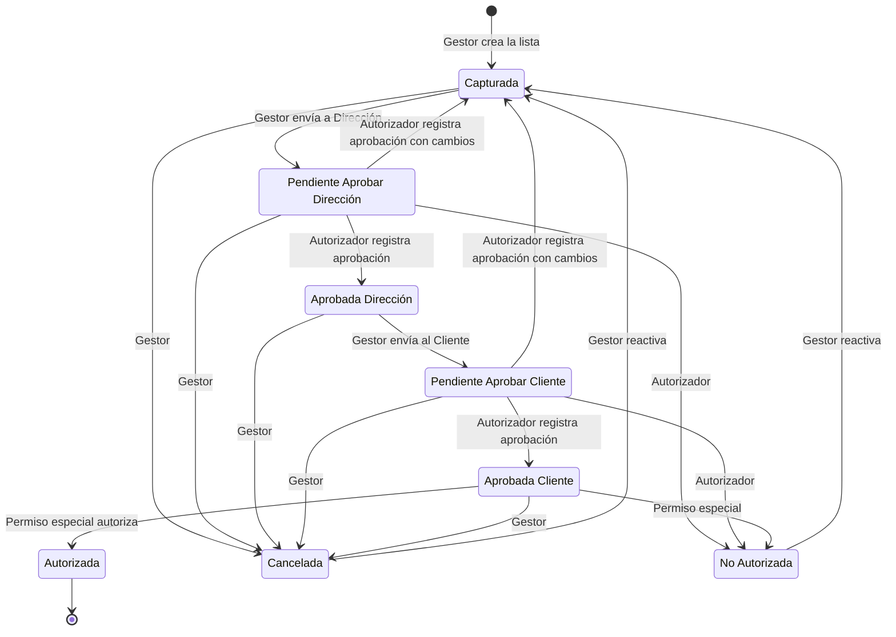
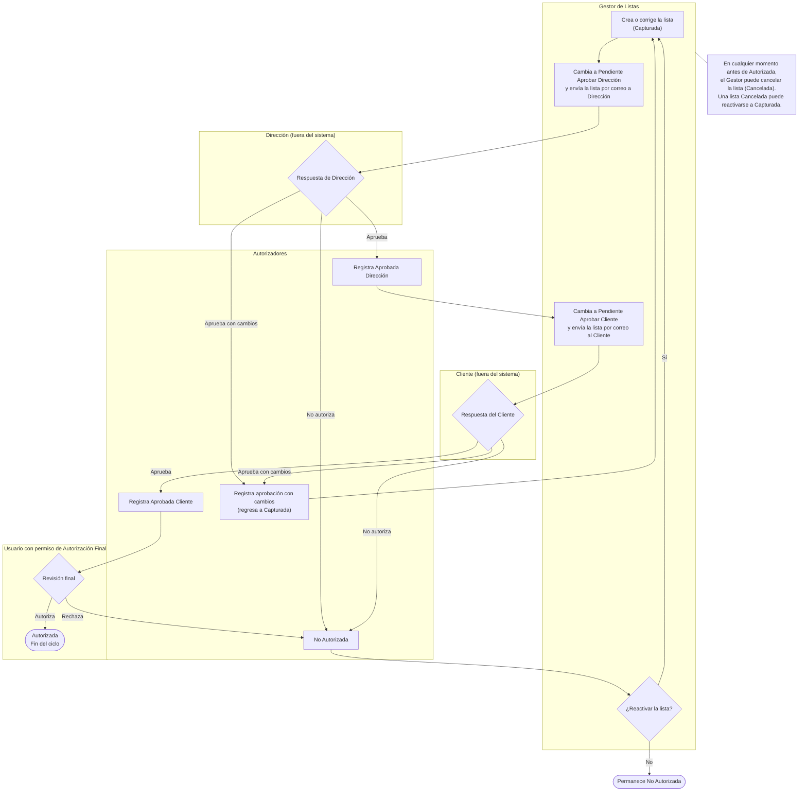

# Diagramas de Flujo – Listas de Precios Personalizadas

Complemento del Documento de Alcance Funcional (sección 2.4, RN-010 a RN-015). Los diagramas están en Mermaid.

## 1. Diagrama de estatus

Muestra todos los estatus de una lista, las transiciones permitidas y quién las ejecuta.

Notas:

* *Autorizada* es el único estatus final. Para cambiar una lista autorizada se crea una nueva versión.
* La lista solo puede modificarse en *Capturada*. Al regresar a *Capturada*, las aprobaciones anteriores dejan de ser válidas y el proceso reinicia desde Dirección.
* Cada cambio de estatus se registra en la bitácora: fecha, usuario, estatus anterior, estatus nuevo y comentario opcional.

## 2. Diagrama de proceso por roles

Muestra quién hace cada paso. Dirección y el Cliente responden por correo, fuera del sistema; los Autorizadores registran su respuesta.

